# AKAR · Figma ile kod karşılaştırması

*13 Ekim 2026. Solda Figma (güncel dosya `Bd3m8xYrCiVK6440POHN39`, Bursa). Sağda kod: `Internet-Kahve/akar-app` main `6b3299a` (10 Ekim), yerelde çalıştırılıp aynı ekran boyutlarında (390×844 ve 1440×900) çekildi.*

Kodda harita karoları bu ortamda yüklenmediği için harita "şematik konum görünümü"ne düştü. Bu kodun hatası değil, yedek görünümün çalıştığını gösteriyor.

## Önce genel farklar (her ekranı etkiliyor)

| # | Konu | Figma | Kod | Ne yapılmalı |
|---|---|---|---|---|
| G1 | **Figma kaynağı** | Güncel dosya `jTSZ…` | Eski dosya `Bd3m8…` (docs/DESIGN-SOURCES.md) | Kod bu dosyaya geçmeli; eski dosya kullanılmasın |
| G2 | **Şehir ve içerik** | Bursa: Ulucami, Bedesten, Koza Hanı, Orhan Gazi Camii | İstanbul: Kılıç Ali Paşa, Tophane | Örnek veri Bursa'ya; hikâye `belgeler/AKAR_Tam_Baglam.md` §0.5 |
| G3 | **Harita stili** | MapLibre + OpenFreeMap, `tasarim/harita/akar-style.json` | OSM raster karo (`tile.openstreetmap.org`) | Stil dosyamız kullanılmalı. OSM'nin kendi karo sunucusu yoğun uygulama kullanımına kapalı (kullanım politikası) |
| G4 | **Harita kontrolleri** | Sağ kenar, dikeyde orta: + / − · konum · 3D dairesi | Sağ üst: konum, +, −, katman | Figma'daki sıra ve yer; katman düğmesi yok |
| G5 | **Mobil gezinme** | Tam ekran harita + sürüklenen alt sayfa (Eserler/Rotalar sekmesi), avatar sağ üstte | Harita üstte sabit, içerik altta kayar, 4 sekmeli alt menü | **Karar gerekli.** Figma'da alt menü yok. Önerim Figma (harita her an görünür kalıyor) |
| G6 | **Marka** | "AKAR" yazısı | "akar." + bina ikonu | Karar: logo henüz çizilmedi; şimdilik Figma |
| G7 | **3D** | three.js sahnesi (.glb), "3D model · Temsili" etiketi, pusula dairesi | CSS ile çizilmiş temsili cami | three.js bağlanmalı (`3d-eser/` ve FRONTEND notları §9) |
| G8 | **Yığın** | Belgeler Vite + React diyor | Next.js 16 + React 19 | Kod doğru olan; belgeleri kodla eşitleyeceğiz |
| G9 | **Şehir rengi, desenler, rota yıldızı** | `--sehir-aksan`, `tasarim/desenler/`, 8 kollu durak | Yok | tokens.css'teki yeni bölümler |
| G10 | **Hareket** | Notlar: FRONTEND notları §8 | Animasyon az | Alt sayfa, kart dönüşümü, 3D dairesi büyümesi… |

## Ekran ekran

### 01 · Mobil · Keşif
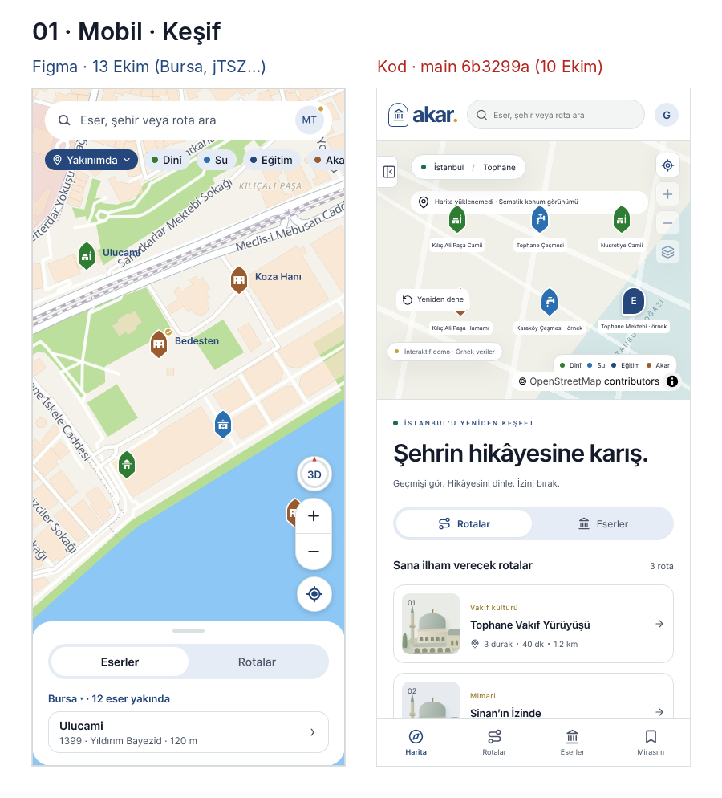
- Figma'da harita tam ekran, rol çipleri (Dinî · Su · Eğitim · Akar) haritanın üstünde, "Yakınımda" konum modu. Kodda "İstanbul / Tophane" yazısı ve ayrı lejant var.
- Kodda "Şehrin hikâyesine karış." başlığı keşif ekranında. Figma'da bu yalnız **İlk açılış** kartında.
- Alt sayfa: Figma'da "Bursa · 12 eser yakında" + liste. Kodda rota kartları resimli büyük kartlar.
- Pin renkleri ve kemer biçimi uyuşuyor. Figma'da Bedesten ve Koza Hanı "Akar" (kahverengi, han ikonu).

### 02 · Mobil · Pine dokununca
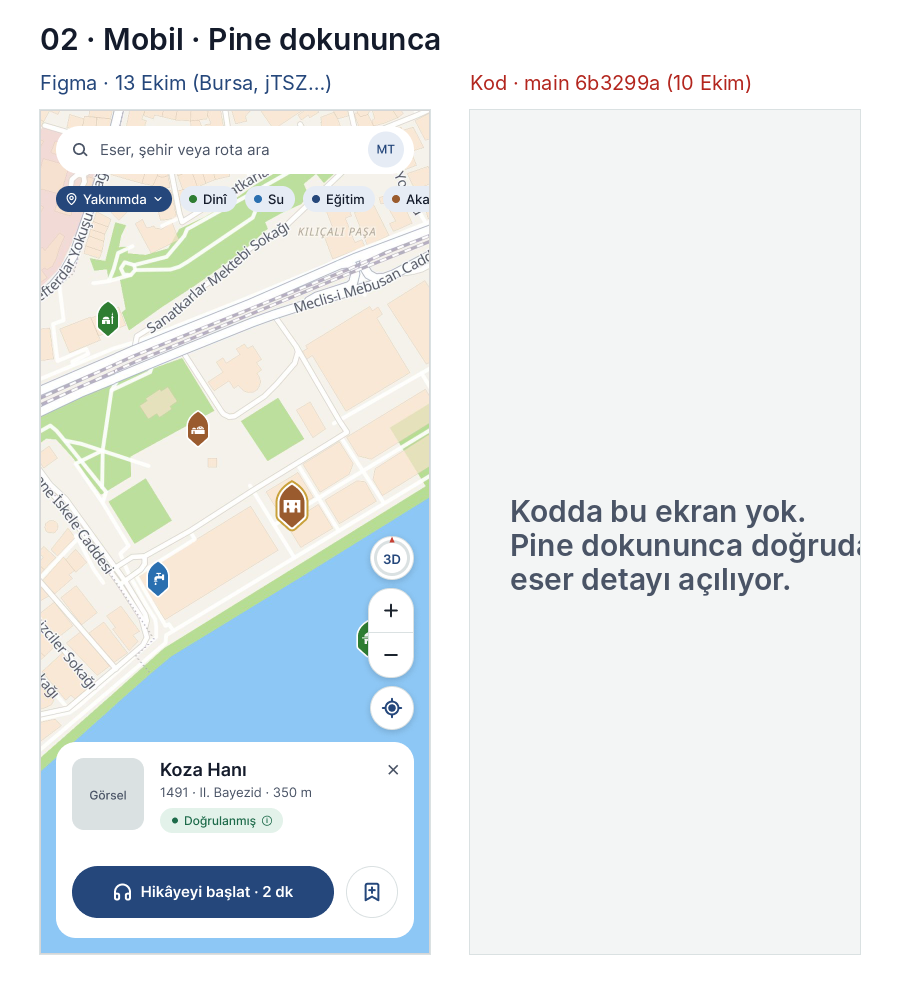
- **Kodda bu ara adım yok.** Pine dokununca doğrudan eser detayı açılıyor.
- Figma: liste sayfası daralıp eser kartına dönüşür (görsel, ad, tarih, güven etiketi, "Hikâyeyi başlat · 2 dk", kaydet). Seçili pin büyür, altın halka alır. Geçiş için bkz. FRONTEND notları §8.

### 03 · Mobil · Eser detay
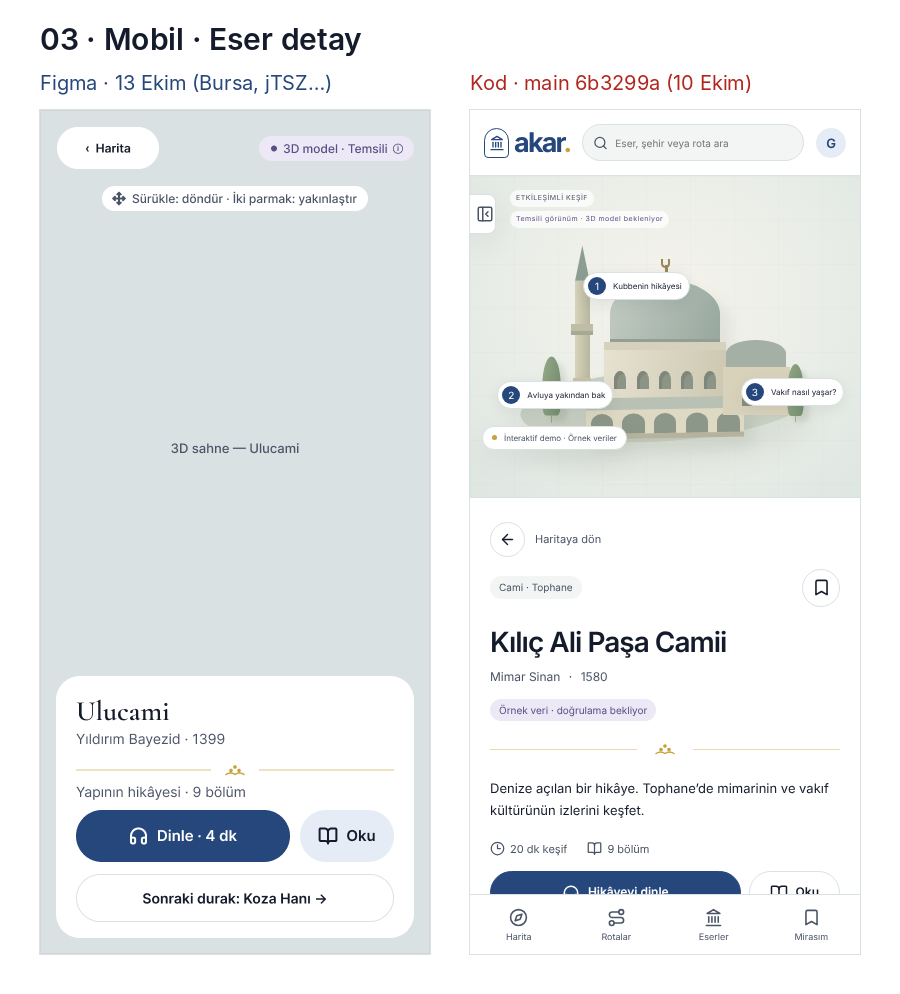
- Figma: üstte tam 3D sahne, "Sürükle: döndür · İki parmak: yakınlaştır" ipucu, sağ üstte güven etiketi. Altta kart: ad, yaptıran · yıl, süsleme çizgisi, Dinle / Oku, "Sonraki durak".
- Kod: temsili çizim üzerinde numaralı noktalar, ayrıca eylem kutuları (Geçmişi Gör, İz Bırak, Bulmaca, Birlikte Gez). **Figma'da bu kutular eser detayından kaldırıldı**, hikâye bittikten sonra çıkıyor.

### 04 · Mobil · Anlatım (Oku)
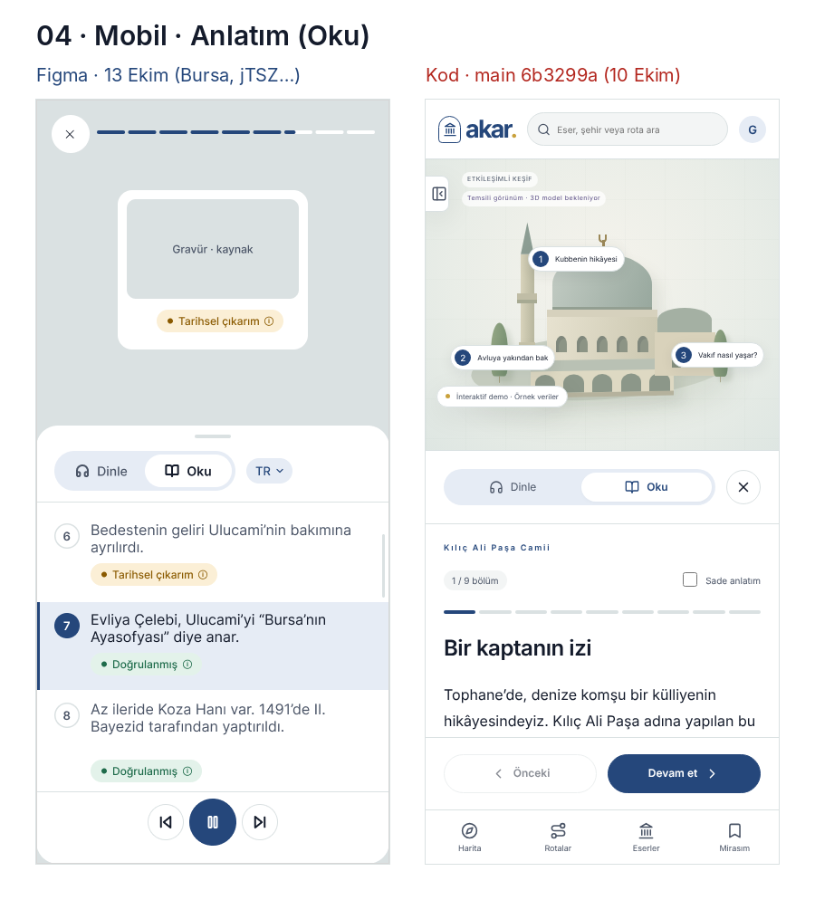
- Figma: cümle cümle liste. Her cümlenin altında güven etiketi, aktif cümle vurgulu, üstte cümle kadar parçalı ilerleme çubuğu, dil seçici (TR), altta oynatma düğmeleri. Üstte sahne (kart / gravür).
- Kod: bölüm başlıklı paragraflar ("Bir kaptanın izi"), "Önceki / Devam et", "Sade anlatım" kutusu.
- Veri modeli artık **cümle = cue** (kaynaklı, açılı). Kodun "bölüm" yapısı cümlelere bölünmeli.

### 05 · Mobil · Rota önizleme
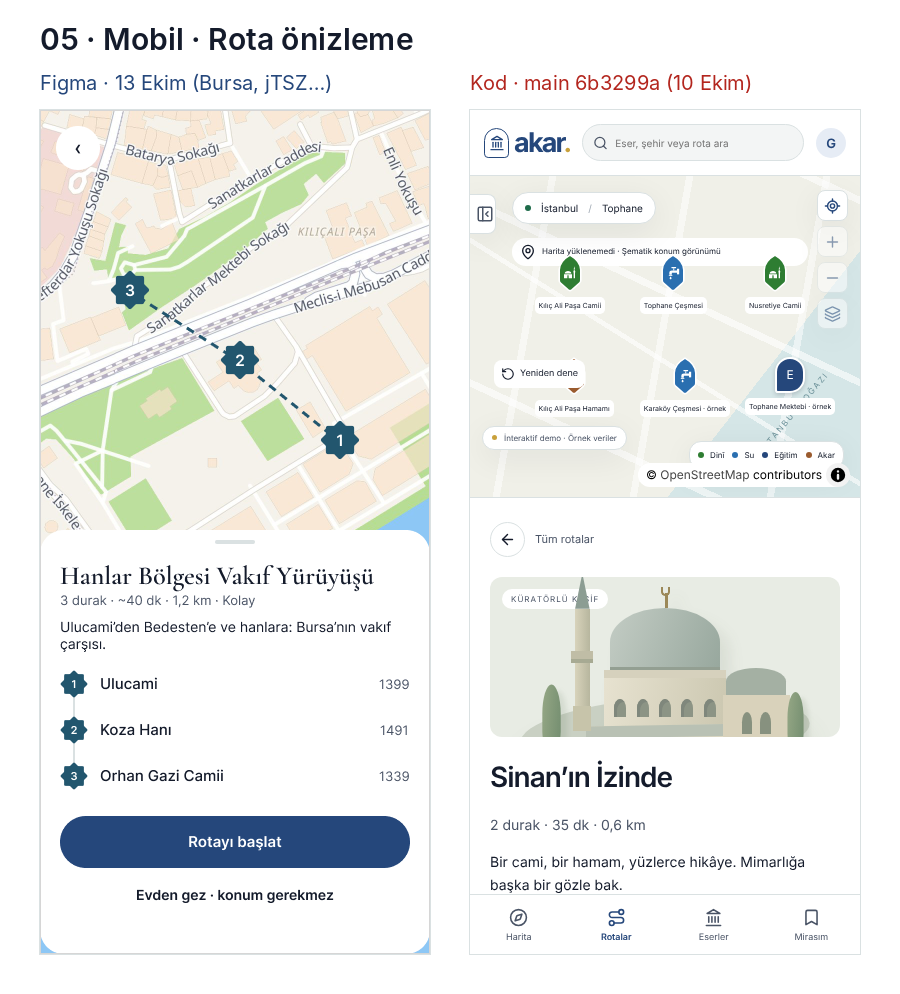
- Figma: harita üstte, duraklar **8 kollu yıldız**, çizgi şehir renginde (Bursa petrol). Altta rota adı (serif), süre/mesafe/zorluk, durak listesi (yıldız + yıl), "Rotayı başlat", "Evden gez · konum gerekmez".
- Kod: rota görseli + numaralı daire listesi. Kodun "Durakları birleştiren çizgi şematiktir" uyarısı iyi, kalsın.

### 06 · Mobil · Bulmaca
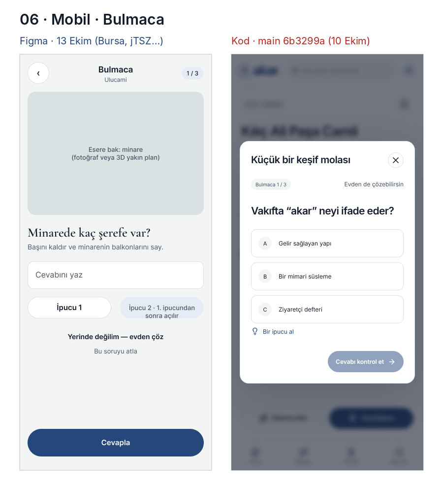
- Figma: esere bakarak çözülen soru ("Minarede kaç şerefe var?"), serbest cevap, iki ipucu, "Yerinde değilim — evden çöz", "Bu soruyu atla".
- Kod: çoktan seçmeli modal (A/B/C).
- **Karar gerekli.** Veri şeması 3 seçenekli. Önerim: **çoktan seçmeli kalsın** (kontrolü kolay, çeviri kolay, kodu hazır), ama Figma'daki "esere bak" görseli ve ipuçları eklensin. Figma'yı buna göre güncelleriz.

### 07 · Masaüstü · Keşif
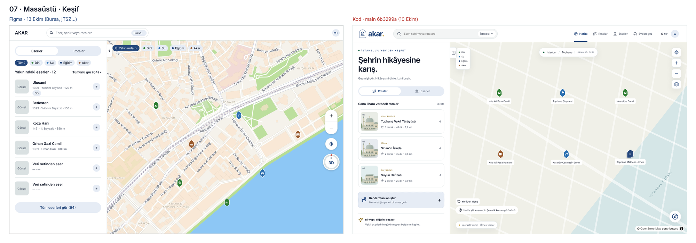
- Figma: üst çubukta yalnız arama + şehir + avatar. Sol panelde Eserler/Rotalar sekmesi, rol filtreleri, yakındaki eserler (görsel, ad, tarih, mesafe, "+ Rotama ekle").
- Kod: üst çubukta Harita/Rotalar/Eserler/Evden gez menüsü ve puan. Sol panelde rota kartları ve "Kendi rotanı oluştur".
- Harita kontrolleri: bkz. G4.

### 08 · Masaüstü · Eser detay
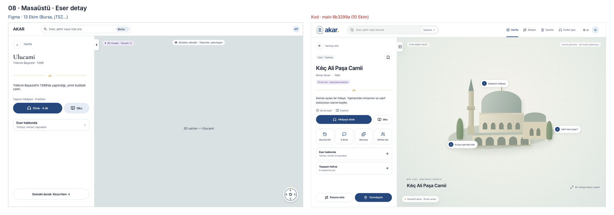
- Figma: sol panel sade (ad, yaptıran · yıl, kısa tanım, Dinle / Oku, Eser hakkında, Sonraki durak), sağda 3D ve pusula dairesi.
- Kod: eylem kutuları ve "Rotama ekle / Yanındayım" düğmeleri panelde. Figma'da bunlar hikâye sonrasında.

### 09 · Masaüstü · Anlatım (Oku)
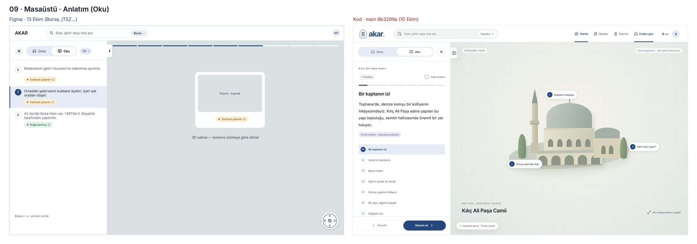
- Figma: sol panelde cümle listesi, sağ üstte cümle sayısı kadar ilerleme çubuğu, sahnede kart / gravür, klavye ipucu "Boşluk / ↓".
- Kod: bölüm listesi ve paragraf, sağda temsili çizim.

### 10 · Masaüstü · Rota önizleme
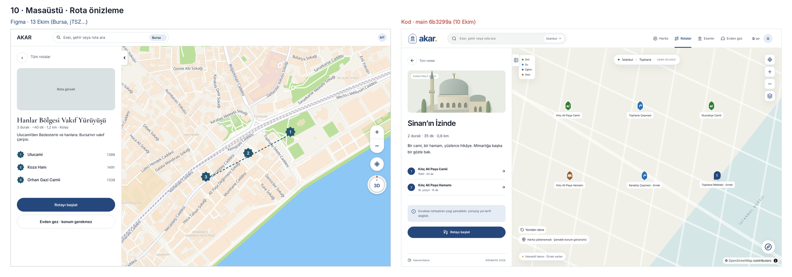
- Figma: yıldız duraklar, şehir rengi kesikli çizgi, kontroller sağda ortada.
- Kod: harita çizgisi yok (karo yüklenmediği için), durak listesi numaralı daire.

### 11 · Masaüstü · Bulmaca
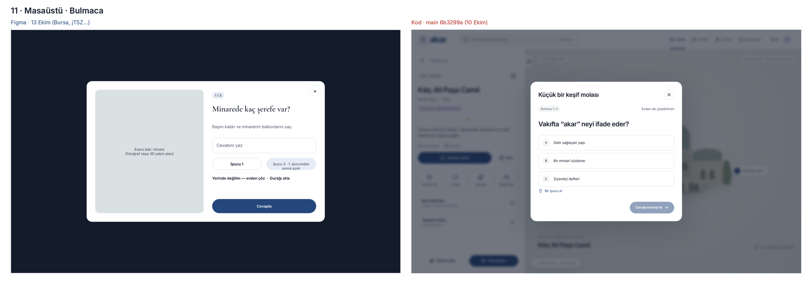
- Figma: solda büyük "esere bak" görseli, sağda soru. Kod: tek sütun çoktan seçmeli. Karar 06'daki ile aynı.

### 12 · Panel · Eser listesi
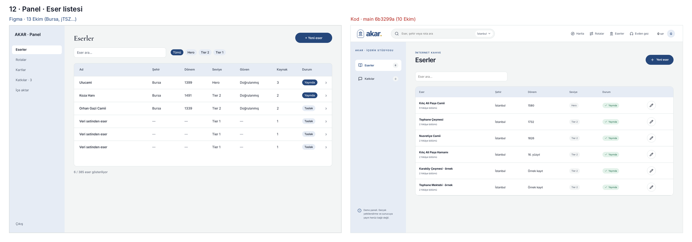
- Figma menü: Eserler · Rotalar · Kartlar · Katkılar · İçe aktar. Tabloda Güven ve Kaynak sütunları var, "6 / 385 eser".
- Kod menü: Eserler · Katkılar. Tabloda düzenle (kalem) düğmesi var.

### 13 · Panel · Yeni eser
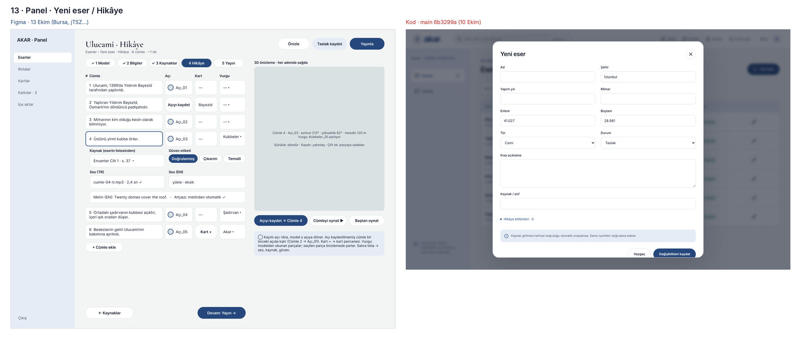
- **En büyük fark.** Figma'da yeni eser 5 adımlı bir akış: Model → Bilgiler → Kaynaklar → Hikâye → Yayın. 3D önizleme hep sağda. Hikâyede her cümleye açı kaydediliyor (daire), kart ve vurgu bağlanıyor.
- Kod: tek modal form (ad, şehir, yıl, mimar, enlem/boylam elle, tür, durum, açıklama, kaynak, hikâye bölümleri).
- Ayrıntılı şema ve kurallar: `belgeler/FRONTEND_BACKEND_NOTLARI.md` §1–§4.

## Kodda iyi olan, Figma'ya taşınabilecekler
- Harita yüklenmezse şematik yedek görünüm ve "Yeniden dene".
- "Örnek veri · doğrulama bekliyor" etiketi (demo verisi için dürüst).
- Klavyeyle çalışan modaller, Escape ile kapanma, kaydırıcıda ok tuşları (testlerde var).
- Rota çizgisinin "şematik" olduğunu söyleyen not.

## Karar bekleyenler (ekip)
1. Mobil alt menü (G5): Figma (alt menü yok) mu, kod (4 sekme) mu?
2. Bulmaca biçimi (06): çoktan seçmeli + esere bak görseli önerisi.
3. Logo (G6).
