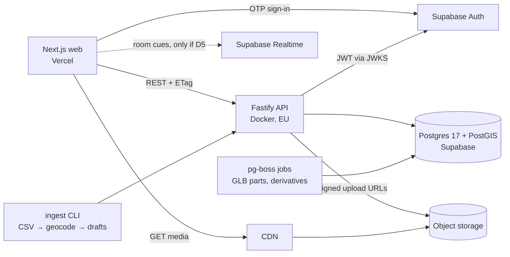

# Akar Backend Plan · Backend Planı

> Tarihli plan/inceleme kaydıdır; güncel kurulum ve canlı özellikler için [doküman rehberini](README.md) kullan. Aşağıdaki durumlar yazıldıkları tarihe aittir.

> Status: **proposal** for team review (20 Oct 2026). Nothing here is final until the team agrees on the decisions in §3.
> Durum: ekip incelemesi için **öneri** (20 Ekim 2026). §3'teki kararlar ekipçe onaylanana kadar hiçbir madde kesin değildir.

> Update (20 Oct 2026): the §3 proposals were approved by the project kickoff. Implementation decisions and their reasons are logged in [BACKEND-DECISIONS.md](BACKEND-DECISIONS.md).
> Güncelleme (20 Ekim 2026): §3 önerileri kickoff ile onaylandı. Uygulama kararları ve gerekçeleri [BACKEND-DECISIONS.md](BACKEND-DECISIONS.md) dosyasında.

- [English](#english)
- [Türkçe](#türkçe)

---

## English

### 1. Inputs

Sources reviewed: competition specification (şartname) and privacy notice PDFs; `CONCEPT`, `ROLLER`, `LANDSCAPE`, `SURDURULEBILIRLIK`; repo docs (`API-HANDOFF`, `ROADMAP`, `FRONTEND-REFRESH`, `REPOSITORY-STRATEGY`); `origin/docs` dataset (`docs/documents-context/veri/`); 3D branches; the **akar-yeni** Figma file (`HGTgq5vRXVqhVO9TcR9wBe`, all annotations and admin forms); the current web app code. Existing proposals (Supabase in Figma, Fastify in the repo) were treated as options, not decisions.

### 2. Requirements that shape the backend

| Requirement | Source | Consequence |
| --- | --- | --- |
| Content can be added and edited; new works added without code changes | Şartname §5.1.1; Figma admin note | Real admin write API |
| Architecture extends to new works, cities and content types | §5.1.2 | Site types and waqf-role categories are **lookup tables**, not enums |
| Third-party services used in the demo must be running | §5.1.2 | Few vendors, paid/kept-awake tiers, local fallback |
| Source shown for every fact; unverified content not presented as fact | §5.1.3; Figma "Kaynaksız cümle yayınlanamaz" | Server-side publish gate (`publicationIssues`), trust level per sentence/photo/paragraph |
| Community contributions moderated before publishing; rejection needs a reason; "Report" returns content to moderation | §5.1.3; Figma 1:1120, 1:7329 | Moderation state machine + audit log |
| Input validation, personal-data protection, tests on critical flows | §5.1.5 | Zod at the boundary, magic-byte file checks, KVKK consent record, integration tests |
| Location is never sent to the server | Figma 1:5791 | Conflicts with `POST /visits/verify` → decision D4 |
| Guest points stay on the device and move to the account at sign-in | Figma 1:599, 1:6975 | Signed receipts (§4) |
| Email OTP (6 digits, 600 s); admins are invited, no self sign-up | Figma 1:3937, 1:997 | Auth provider with OTP + invites |
| Bursa: 385 works (CSV ≈ 408 rows), only 12 OSM coordinates, 1,975 photos (2400 px), GLB 60 KB–5.5 MB | `origin/docs` `veri/`, 3D branches | Ingest with geocoding + review; object storage + CDN |
| Import result "362 ready / 18 no location / 5 type unclear / 0 duplicates" | Figma 1:1149 | Import = dry run → commit as Tier 1 drafts |

Not specified anywhere: target scale numbers and hosting. Both are treated as decisions.

### 3. Decisions for the team

| # | Decision | Options | Proposal |
| --- | --- | --- | --- |
| D1 | Backend shape | **A** our API is the authority, Supabase is infrastructure · **B** all-Supabase (PostgREST + RLS + Edge Functions) · **C** fully self-built | **A** |
| D2 | API hosting | Fly.io / Render / Railway (Docker, Frankfurt) | Fly or Render, paid tier during demo week |
| D3 | Media storage | Supabase Storage / Cloudflare R2 | Supabase Storage (one vendor); R2 if egress cost matters |
| D4 | Visit verification vs "location never leaves the device" | (a) client-side geofence, visit marked self-reported · (b) coordinates sent once, verified, never stored | **(b)** with a KVKK note; (a) if the team keeps the Figma rule |
| D5 | "Birlikte Gez" rooms | Cut · Supabase Realtime broadcast · own WebSocket | Cut unless phases P1–P4 finish by 1 Nov; then Realtime broadcast |
| D6 | Admin login | Password (Figma 1:981) · OTP like users | OTP for everyone |
| D7 | Quiz format | 3 options (1:1290) · free text (1:7168) | 3 options, answer key server-side only |
| D8 | Data region / KVKK | EU (Frankfurt) with consent text · Turkey | EU for the hackathon; KVKK text states the cross-border transfer (needs review) |

**Why A:** keeps the existing tested backend and the rule "reuse `@akar/domain` validators"; the server stays authoritative for points, roles, quiz keys and moderation (API-HANDOFF); still gets Supabase OTP/invites. Option B would rewrite domain rules in SQL/RLS and Deno functions. Option C puts OTP, sessions and email on us. Under A, clients never access tables directly; RLS is deny-all as a second line of defense.

### 4. Key designs

- **Guest progress without trusting the client.** Server-checked actions (quiz submit, story complete) return an HMAC-signed receipt even for guests. On sign-in the device sends its receipts; the server verifies and records each action once. Points are always recomputed from the event log, never accepted from the client.
- **Ingest.** `ingest` module + CLI: read CSV → `normalize()` → map type/role → geocode (OSM first, then Nominatim with cache) → report → commit as Tier 1 drafts. The admin import screen uses the same service (dry run, then commit). Duplicate key: normalized name + district.
- **Extensibility (§5.1.2).** `site_types` and `role_categories` (Dinî · Su · Eğitim · Akar) are tables. New city = imported data. New content type = new media kind.
- **Content model v2.** Sites: period, patron, address. `site_sections` for "About" paragraphs (History / Architecture / Waqf & akar) with trust + source. Story blocks: camera angle, card flag, highlight, TR/EN audio. Shared `cards`. `history_images` for "Geçmişi Gör" with optional present-day pair. Routes: city, theme, badge; stops: quiz + history image. Route duration/distance computed (PostGIS length of the stop chain + narration minutes).
- **Media.** Signed uploads, size limits (photo ≤ 5 MB, GLB ≤ 5 MB with Draco), magic-byte checks; GLB part names extracted in a background job; photos served as 1200 px WebP + thumbnails through the CDN.
- **Offline.** Read endpoints already send ETag/Cache-Control. Add `GET /v1/routes/:id/bundle` so a service worker can pre-cache a route.
- **Demo resilience.** Laptop fallback: `docker compose` + seeded database, web app pointed at it if the venue network fails.

### 5. Phases (today 20 Oct · freeze 6 Nov · final 7–8 Nov)

| Phase | Dates | Scope | Owner |
| --- | --- | --- | --- |
| P0 Decide + commit | 20–21 Oct | Agree D1–D8; commit API foundation + read API | Weissman + team |
| P1 Schema v2 + ingest | 21–23 Oct | Replace uncommitted migration `0002`; lookup tables; content model v2; Bursa CSV ingest with geocoding report | Backend, Talha for data mapping |
| P2 Read API v2 | 23–24 Oct | Filters (city, type, period, content, role chips, distance sort); `GET /v1/cities` with counts; sections, cards, history images; route bundle | Backend |
| P3 Auth + media + admin writes | 24–28 Oct | Supabase JWT + roles (admin/editor/moderator), invites; signed upload; 5-step site wizard endpoints + publish gate; import dry-run/commit; route and card editors; audit log | Backend (parallel modules) |
| P4 Users + moderation | 27–30 Oct | İz Bırak (pending, KVKK consent); moderation with reasons + Report; saved, progress "5/9", quizzes, badges, event-log points, guest receipts; visit check per D4 | Backend (parallel modules) |
| P5 Integration + deploy | 29 Oct–1 Nov | HTTP adapter in `packages/api-client` (with Tamer); deploy; load real content | Weissman + Tamer |
| P6 Hardening | 1–5 Nov | Device tests (Redmi 9T), demo-path e2e, rate limits, rooms only if D5, laptop fallback rehearsal | Everyone |

If the frontend needs real data earlier, P2 endpoints are enough to start the adapter on 24 Oct.

### 6. Open questions outside code

- Who holds the sponsor dataset, and under which license?
- Does a web app count as "desktop" under §2?
- KVKK text: retention period and data controller (Figma 1:7557).

---

## Türkçe

### 1. Girdiler

İncelenen kaynaklar: yarışma şartnamesi ve aydınlatma metni PDF'leri; `CONCEPT`, `ROLLER`, `LANDSCAPE`, `SURDURULEBILIRLIK`; repo belgeleri (`API-HANDOFF`, `ROADMAP`, `FRONTEND-REFRESH`, `REPOSITORY-STRATEGY`); `origin/docs` veri seti (`docs/documents-context/veri/`); 3D branch'leri; **akar-yeni** Figma dosyası (`HGTgq5vRXVqhVO9TcR9wBe`, tüm notlar ve panel formları); mevcut web uygulaması kodu. Var olan öneriler (Figma'daki Supabase, repodaki Fastify) karar değil seçenek olarak ele alındı.

### 2. Backend'i şekillendiren gereksinimler

| Gereksinim | Kaynak | Sonuç |
| --- | --- | --- |
| İçerik eklenip düzenlenebilmeli; yeni eser kod değişmeden eklenmeli | Şartname §5.1.1; Figma panel notu | Gerçek yönetim (yazma) API'si |
| Mimari yeni eser, şehir ve içerik türüne genişleyebilmeli | §5.1.2 | Yapı türleri ve vakıf rolü kategorileri enum değil **tablo** |
| Demoda kullanılan üçüncü taraf servisler çalışır olmalı | §5.1.2 | Az sağlayıcı, ücretli/uyanık tutulan katman, yerel yedek |
| Her bilginin kaynağı gösterilmeli; doğrulanmamış bilgi kesin sunulmamalı | §5.1.3; Figma "Kaynaksız cümle yayınlanamaz" | Sunucuda yayın kapısı (`publicationIssues`), cümle/fotoğraf/paragraf başına güven etiketi |
| Katkılar yayından önce onaylanmalı; ret nedeni zorunlu; "Bildir" moderasyona geri gönderir | §5.1.3; Figma 1:1120, 1:7329 | Moderasyon durum makinesi + audit kaydı |
| Girdi doğrulama, kişisel veri koruması, kritik akışlarda test | §5.1.5 | Sınırda Zod, dosya türünü içerikten doğrulama, KVKK onay kaydı, entegrasyon testleri |
| Konum sunucuya hiç gönderilmez | Figma 1:5791 | `POST /visits/verify` ile çelişir → karar D4 |
| Misafir puanı cihazda tutulur, girişte hesaba aktarılır | Figma 1:599, 1:6975 | İmzalı makbuzlar (§4) |
| E-posta OTP (6 hane, 600 sn); yöneticiler davet edilir, kayıt yok | Figma 1:3937, 1:997 | OTP ve davet destekleyen kimlik sağlayıcı |
| Bursa: 385 eser (CSV ≈ 408 satır), yalnız 12 OSM koordinatı, 1.975 fotoğraf (2400 px), GLB 60 KB–5,5 MB | `origin/docs` `veri/`, 3D branch'leri | Coğrafi kodlamalı ve incelemeli içe aktarma; nesne depolama + CDN |
| İçe aktarma sonucu "362 hazır / 18 konum bulunamadı / 5 tür belirsiz / 0 kopya" | Figma 1:1149 | İçe aktarma = deneme → onay, Tier 1 taslak olarak |

Hiçbir kaynakta belirtilmeyenler: hedef ölçek sayıları ve barındırma. İkisi de karar olarak ele alındı.

### 3. Ekip kararları

| # | Karar | Seçenekler | Öneri |
| --- | --- | --- | --- |
| D1 | Backend yapısı | **A** yetkili kendi API'miz, Supabase altyapı · **B** tamamen Supabase (PostgREST + RLS + Edge Functions) · **C** tamamen kendi yazdığımız | **A** |
| D2 | API barındırma | Fly.io / Render / Railway (Dockefly ir, Frankfurt) | Fly veya Render, demo haftasında ücretli katman |
| D3 | Medya depolama | Supabase Storage / Cloudflare R2 | Supabase Storage (tek sağlayıcı); trafik maliyeti önemliyse R2 |
| D4 | Ziyaret doğrulama ve "konum cihazdan çıkmaz" kuralı | (a) cihazda geofence, ziyaret "beyan" olarak işaretlenir · (b) koordinat bir kez gönderilir, doğrulanır, saklanmaz | KVKK notuyla **(b)**; ekip Figma kuralını korursa (a) |
| D5 | "Birlikte Gez" odaları | Çıkar · Supabase Realtime broadcast · kendi WebSocket'imiz | P1–P4 1 Kasım'a kadar bitmezse çıkar; biterse Realtime broadcast |
| D6 | Yönetici girişi | Şifre (Figma 1:981) · kullanıcılar gibi OTP | Herkes için OTP |
| D7 | Bulmaca biçimi | 3 seçenek (1:1290) · serbest metin (1:7168) | 3 seçenek, cevap anahtarı yalnız sunucuda |
| D8 | Veri bölgesi / KVKK | AB (Frankfurt) + onay metni · Türkiye | Hackathon için AB; KVKK metni yurt dışı aktarımı belirtir (gözden geçirilmeli) |

**Neden A:** test edilmiş mevcut backend ve "`@akar/domain` doğrulayıcılarını yeniden kullan" kuralı korunur; puan, rol, bulmaca cevabı ve moderasyonda yetkili taraf sunucu olur (API-HANDOFF); Supabase OTP ve davet yine kullanılır. B, domain kurallarını SQL/RLS ve Deno fonksiyonlarında yeniden yazmayı gerektirir. C, OTP, oturum ve e-posta yükünü bize bırakır. A'da istemciler tablolara doğrudan erişmez; RLS ikinci savunma hattı olarak her şeyi reddeder.

Mimari şema için İngilizce bölümdeki diyagrama bakın.

### 4. Temel tasarımlar

- **İstemciye güvenmeden misafir ilerlemesi.** Sunucuda kontrol edilen işlemler (bulmaca gönderme, hikâye tamamlama) misafire de HMAC ile imzalı bir makbuz döndürür. Girişte cihaz makbuzlarını gönderir; sunucu doğrular ve her işlemi bir kez kaydeder. Puan her zaman olay kaydından hesaplanır, istemciden kabul edilmez.
- **İçe aktarma.** `ingest` modülü + CLI: CSV okunur → `normalize()` → tür/rol eşlenir → coğrafi kodlama (önce OSM, sonra önbellekli Nominatim) → rapor → Tier 1 taslak olarak kaydedilir. Paneldeki İçe aktar ekranı aynı servisi kullanır (önce deneme, sonra onay). Kopya anahtarı: normalize ad + ilçe.
- **Genişletilebilirlik (§5.1.2).** `site_types` ve `role_categories` (Dinî · Su · Eğitim · Akar) tablodur. Yeni şehir = içe aktarılan veri. Yeni içerik türü = yeni medya türü.
- **İçerik modeli v2.** Eser: dönem, yaptıran, adres. "Eser hakkında" paragrafları için `site_sections` (Tarihçe / Mimari / Vakıf ve akar), güven + kaynak ile. Hikâye cümlesi: kamera açısı, kart işareti, vurgu, TR/EN ses. Eserler arasında paylaşılan `cards`. "Geçmişi Gör" için isteğe bağlı bugünkü eşiyle `history_images`. Rota: şehir, tema, rozet; durak: bulmaca + eski görsel. Rota süresi ve mesafesi hesaplanır (durak zincirinin PostGIS uzunluğu + anlatım süresi).
- **Medya.** İmzalı yükleme, boyut sınırları (fotoğraf ≤ 5 MB, Draco'lu GLB ≤ 5 MB), dosya türünün içerikten kontrolü; GLB parça adları arka plan işinde çıkarılır; fotoğraflar CDN üzerinden 1200 px WebP + küçük görsel olarak sunulur.
- **Çevrimdışı.** Okuma uçları zaten ETag/Cache-Control gönderiyor. Bir rotanın önceden önbelleğe alınabilmesi için `GET /v1/routes/:id/bundle` eklenir.
- **Demo güvencesi.** Dizüstü yedeği: `docker compose` + tohumlanmış veritabanı; salonun ağı çökerse web uygulaması buna bağlanır.

### 5. Aşamalar (bugün 20 Ekim · dondurma 6 Kasım · final 7–8 Kasım)

| Aşama | Tarih | Kapsam | Sorumlu |
| --- | --- | --- | --- |
| P0 Karar + commit | 20–21 Ekim | D1–D8 onayı; API temeli + okuma API'si commit | Weissman + ekip |
| P1 Şema v2 + içe aktarma | 21–23 Ekim | Commit edilmemiş `0002` migration'ının yerine yenisi; tablo tabanlı türler; içerik modeli v2; coğrafi kodlama raporlu Bursa CSV içe aktarma | Backend, veri eşleme için Talha |
| P2 Okuma API'si v2 | 23–24 Ekim | Filtreler (şehir, tür, dönem, içerik, rol çipleri, mesafeye göre sıralama); sayılarıyla `GET /v1/cities`; bölümler, kartlar, eski görseller; rota paketi | Backend |
| P3 Kimlik + medya + panel yazma | 24–28 Ekim | Supabase JWT + roller (yönetici/editör/moderatör), davet; imzalı yükleme; 5 adımlı eser sihirbazı uçları + yayın kapısı; içe aktarma deneme/onay; rota ve kart editörleri; audit kaydı | Backend (paralel modüller) |
| P4 Kullanıcı + moderasyon | 27–30 Ekim | İz Bırak (beklemede, KVKK onayı); nedenli moderasyon + Bildir; kaydedilenler, ilerleme "5/9", bulmaca, rozet, olay kaydından puan, misafir makbuzları; D4'e göre ziyaret doğrulama | Backend (paralel modüller) |
| P5 Entegrasyon + yayına alma | 29 Ekim–1 Kasım | `packages/api-client` içinde HTTP adaptörü (Tamer ile); deploy; gerçek içeriğin yüklenmesi | Weissman + Tamer |
| P6 Sağlamlaştırma | 1–5 Kasım | Cihaz testleri (Redmi 9T), demo yolu e2e, rate limit, D5 onaylıysa odalar, dizüstü yedeğinin provası | Herkes |

Frontend gerçek veriye daha erken ihtiyaç duyarsa P2 uçları 24 Ekim'de adaptöre başlamak için yeterlidir.

### 6. Kod dışı açık sorular

- Sponsor veri setini kim tutuyor, lisansı nedir?
- Web uygulaması §2'deki "masaüstü" tanımına giriyor mu?
- KVKK metni: saklama süresi ve veri sorumlusu (Figma 1:7557).
