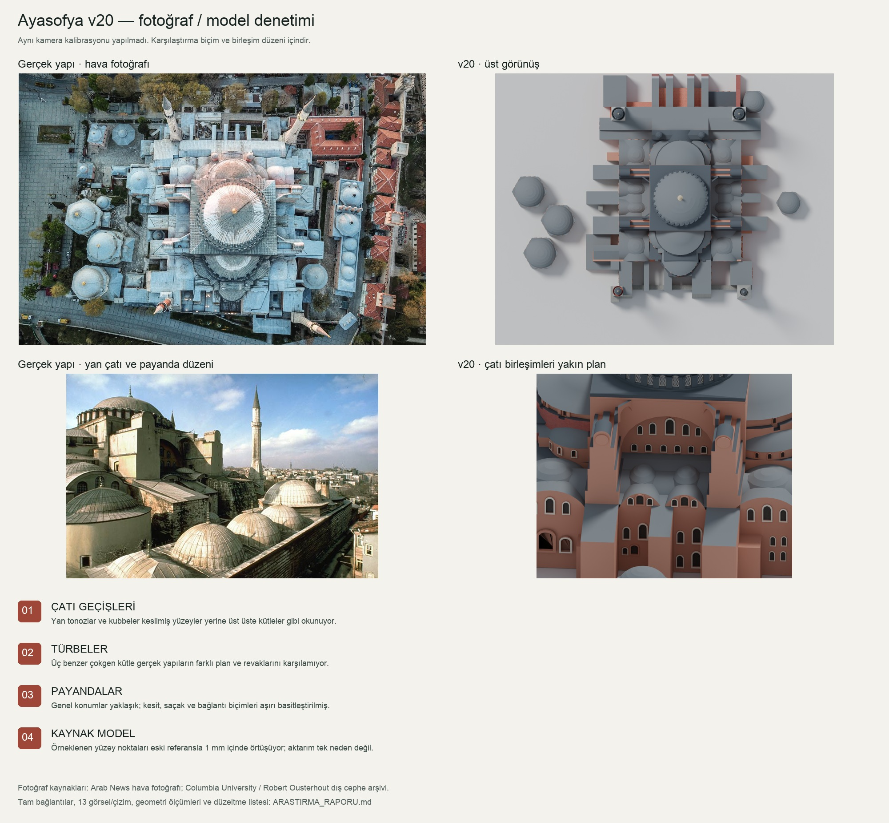

# Ayasofya v20 — fotoğraf ve geometri denetimi

**19 Ekim 2026 · Sonuç: v20 mimari doğruluk açısından tamamlanmış kabul edilmemeli.**

Kullanıcının “parçalar birbirine girmiş gibi” tespiti üzerine, modelin genel görüntüsü yerine çatı birleşimleri, payandalar, türbeler ve kaynak ağ incelendi. 13 ayrı fotoğraf/çizim yerel araştırma klasörüne kaydedilip görüntülendi: 7 Columbia dış cephe fotoğrafı, 4 plan/kesit/izometrik çizim, 1 yüksek çözünürlüklü genel fotoğraf, 1 hava fotoğrafı. Columbia'nın 2013 güneydoğu fotoğrafı ayrıca tarayıcıda incelendi. Kültür ve Turizm Bakanlığı'nın türbe tanımlarıyla biçim kontrolü yapıldı.

Önceki kontrolde yapılan GLB yeniden açma testi dosyanın aktarımını doğruluyordu. Mimari birleşimlerin doğru olduğunu göstermiyordu. Önceki teslimde bu ayrım yeterince güçlü yapılmadı.

## 1. Kaynak mı, aktarım hatası mı?

`compare_source.py`, eski `img-ref5/ref5_dae_olcu.glb` ile v20 arasında iki yönlü, örneklenmiş nokta–üçgen yüzeyi uzaklığı ölçer. İkisine de aynı eski proje dönüşümü uygulanır.

| Karşılaştırma | Örnek | En büyük uzaklık | 1 mm içinde |
|---|---:|---:|---:|
| Eski referans → v20 | 5.103 | 0,0000346 m | %100 |
| v20 → eski referans | 5.462 | 0,0000171 m | %100 |

**Çıkarım:** İncelenen yüzey örneklerinde parçaların yeni içe aktarım nedeniyle metrelerce kaydığına dair bulgu yok. v20 kaynak ağın biçimini çok yakından taşıyor. Dolayısıyla kaynak modelin kaba/yanlış birleşimleri de aktarılmış. Bu bir örnekleme testidir; bütün yüzeylerin, malzemelerin veya normallerin birebir doğruluğunu kanıtlamaz.

Ayrıca eski projeden alınan yatay **1,32**, düşey **1,1347** ölçekler, kaynağa göre yatay/düşey oranı yaklaşık **%16,3** değiştirir. “Kaynağa sadık” ifadesi bu dönüşümü saklamamalıdır. Bu ölçeklerin gerçek yapıya uygunluğu bu araştırmada yeniden metrik olarak kalibre edilmedi; sonraki kurulumun başlangıcında yeniden ele alınmalı.

## 2. Fotoğraflarla belirlenen sorunlar

| Öncelik / bölge | v20 bulgusu | Fotoğraf veya plan kanıtı | Düzeltme kararı |
|---|---|---|---|
| **P1 · Yan galeri çatıları** | Küçük kubbe/tonoz çıkıntıları eğimli çatıların içine gömülmüş ayrı hacimler gibi okunuyor. Bazı yüzeyler tek bir kesişim hattında sonlanmıyor. | S02 yan çatı fotoğrafı, S08 hava fotoğrafı ve model yakın planı birlikte incelendi. Gerçekte kurşun örtü, kenarlar ve mahyalar bir çatı sistemi oluşturuyor. | Yan çatı kabuklarını doğru sınırlarla yeniden kur; kubbe/tonoz birleşiminde iki görünür yüzeyi birbirinin içinden geçirme. |
| **P1 · Türbeler** | Üç büyük yan yapı çok benzer, çokgen ve çok katlı pencere tekrarlı kütleler. Giriş revakları ve birbirinden farklı plan karakterleri yok. | S09 genel fotoğraf ve KTB tanımı: II. Selim köşeleri pahlanmış kare; III. Mehmed sekizgen; III. Murad altıgen esaslı, kırılan kenarlarla düzensiz sekizgen. | Üçünü ayrı plan, gövde, kubbe ve revakla modelle. Aynı kütleyi kopyalayıp ölçekleme yeterli değil. |
| **P1 · Payandalar ve yüksek yan kuleler** | Büyük düz prizmalar, kalın basamaklar ve çatıdan geçen parçalar baskın. Bazı yüzey birleşimlerinde keskin koyu yarıklar var. | S02, S05, S07. Gerçek payandalar çeşitli kesitlere, kurşun kaplı üstlere ve bağlantı ayrıntılarına sahip. | Cephe bazında ayır; her payandanın kademesini ve bitişini fotoğrafla eşleştir. Koyu çizgilerin tümünü “hata” sayma: bazıları gerçek saçak/gölge. |
| **P1 · Yarım kubbe–eksedra–apsis geçişleri** | Çatı kabukları ve kasnaklar üst üste bindirilmiş basamaklı parçalar gibi okunuyor; saçak bantları yer yer kesiliyor. | S06 yakın kubbe fotoğrafı, S08 hava fotoğrafı, S11 boyuna kesit. | Önce ana yarım kubbe ve alt eksedra sınırlarını çöz, sonra kasnak ve saçağı aynı sınırda sonlandır. |
| **P2 · Ana kubbe ve kasnak** | Kubbe yüzeyinde düşük segment sayısına bağlı halkalar var; kurşun levha derzleri/kaburgalar yok. Kasnak payandaları kalın dişler gibi. | S06 kasnak ayrıntısı, S09 yüksek çözünürlüklü fotoğraf. | Kubbe eğrisini daha düzgün üret; okunur, ince kurşun derzleri ve gerçek pencere-payanda profillerini ekle. |
| **P2 · Pencereler ve timpan** | Birçok açıklık tek tip koyu kemer paneline indirgenmiş; gerçek çerçeve/şebeke ve derinlik çeşitliliği kaybolmuş. | S01, S05, S09. İki cephenin ayrıntılarını birbirine kopyalayarak çözmek yeterli değil. | Her cephede açıklık düzenini ayrı eşleştir; sayıları net görünen fotoğraftan işaretle, görünmeyenleri tahmin olarak etiketle. |
| **P2 · Minareler** | Temel dört minare ayrımı var ama kaide geçişi, gövde kesiti, şerefe altı ve külah ayrıntıları kaba; bazıları birbirine fazla benziyor. | S01, S05, S09. | Dört ayrı profil kur. Bu turda kesin yükseklik düzeltmesi yapılmadı; perspektif fotoğraftan doğrudan metre çıkarılmadı. |
| **P2 · Narteks ve dış bağlantılar** | Batıdaki uzun çatı ve dış destekler tekdüze bloklar halinde. Ana yapının yakın çevresi ve yan yapılar arasındaki ilişki eksik. | S08 hava fotoğrafı, S10 zemin planı. | Çatı ayak izini ve giriş/yan yapı ilişkilerini ayrı katmanlar olarak eşleştir. Tarihsel planı bugünkü eklentilerin birebir planı sayma. |
| **P2 · Renk ve yüzey okuması** | Çatılar koyu ve düz, duvarlar tek renk, bazı taş dokuları her yüzeyde aynı ölçekte. Böylece ayrı malzemeler de birbirine karışıyor. | S02 ile S09 farklı ışıkta incelendi. | Önce geometri; sonra nötr ışık altında malzeme ve tutarlı doku ölçeği. Tek fotoğrafın ışığını malzeme rengi kabul etme. |

KTB türbe kanıtı: [İstanbul Türbeler Müze Müdürlüğü](https://kvmgm.ktb.gov.tr/TR-44099/istanbul-turbeler-muze-mudurlugu.html), “Sultan II. Selim”, “Sultan III. Mehmed”, “Sultan III. Murad” bölümleri. Yukarıdaki türbe özeti bu tanımlara dayanır; diğer biçim değerlendirmeleri fotoğraflardan yaptığım görsel çıkarımlardır.

## 3. Sayısal geometri denetimi

`audit_geometry.py` sonuçları:

- 32.770 köşe; 67.289 üçgen.
- 24 bağlı geometri bileşeni. Bunlar mimari parça isimleri değildir; birbirine değen yapılar aynı bileşende birleşebilir.
- 1.634 sınır kenarı.
- Toplam 4.480 manifold olmayan kenar; bu sayı sınır kenarlarını da içerir, iki sayı toplanmaz.
- Dört dış bakış noktasından ışın testiyle görünür olabilecek **1.604 üçgen çifti kesişim parçası adayı**. Ortak köşeli çiftler, aynı düzlemdeki çiftler ve 5 cm'den kısa parçalar filtrelendi.

**1.604 bağımsız hata anlamına gelmez.** Tek bir mimari birleşim çok sayıda üçgen çiftine yayılır. Duvar–payanda temasları ve çatının duvarla birleşmesi doğal kesişimler içerebilir. Açık alt yüzler de dışarıdan görünmeyebilir. Bu rakamlar sorun bulmak için tarama ölçütüdür; otomatik “hata silme” listesi değildir.

Örnek: yan galeride iki çatı malzemesi yüzeyi arasında yaklaşık 17,07 m uzunluğunda bir kesişim adayı var (üçgenler 6879/11106, model koordinatı yaklaşık 11,18 / 19,22 / 21,54 m). Bu bölge `model_cati_birlesim.png` ile ayrıca görüntülendi. Sonraki düzeltmede kesişim hattı korunması gereken gerçek bir mahya mı, yüzey taşması mı diye kaynak fotoğrafla kontrol edilmeli.

## 4. Yeni sürüm için uygulama sırası ve kabul ölçütleri

1. **Koordinat ve silüet:** Ana kubbe, doğu–batı yarım kubbeler, apsis, narteks ve dört minareyi isimli nesnelere ayır. Ölçekleri plan/kesit ve en az iki açıyla kontrol et.
2. **Temiz çatı ve payanda ağı:** Yan galeri çatılarını ve geçişleri yeniden kur. Görünen kabuklar ortak sınırda bitmeli; açık uç ve yüzey taşmaları yakın planda kontrol edilmeli. Körlemesine boolean veya genel remesh, pencere/şebeke detaylarını bozabileceğinden kullanılmamalı.
3. **Ayrı türbeler:** Her türbenin planı ve revakı ayrı kaynakla eşleştirilmeli. Kaynaktaki üç benzer kütle nihai geometri kabul edilmemeli.
4. **Cephe ayrıntıları:** Pencere dizilimi, kasnak payandası, saçak, minare profili, kurşun derzleri; ana kütle doğrulandıktan sonra.
5. **Kontrol:** Aynı kameralarla önce/sonra; üst görünüş + dört cephe + birleşim yakın planları. Görünür kesişim adayları mimari olarak sınıflandırılmalı. GLB yeniden açma en son teknik kontrol olarak kalmalı.

**Bu tur model değişikliği yapılmadı.** Araştırma ve teşhis tamamlandı; v20'nin mimari sorunları çözülmüş gibi yeni sürüm numarası verilmedi. Bu rapor, sonraki düzeltmenin somut iş listesidir. Fotoğrafların kamera konumları metrik olarak kalibre edilmedi; “%X gerçeğe uygunluk” veya santimetre doğruluğu iddiası yok.

## 5. Kaynak envanteri

Tüm görseller yalnız bu yerel inceleme için; uygulama dokusu olarak kullanılmadı. Küçük önizlemeler sayıya dahil edilmedi.

| ID | Kaynak / belge | İncelenen kullanım |
|---|---|---|
| S01 | [Columbia — dış cephe 01](https://projects.mcah.columbia.edu/medieval-architecture/htm/or/ma_or_image_hs_exter01.htm) | Genel silüet, minareler |
| S02 | [Columbia — yan kubbeler](https://projects.mcah.columbia.edu/medieval-architecture/htm/or/ma_or_image_hs_exter02.htm) | Yan çatılar ve kütle geçişleri |
| S03 | [Columbia — dış cephe 03](https://projects.mcah.columbia.edu/medieval-architecture/htm/or/ma_or_image_hs_exter03.htm) | Türbe ve cephe ilişkisi |
| S04 | [Columbia — uzaktan görünüş](https://projects.mcah.columbia.edu/medieval-architecture/htm/or/ma_or_image_hs_exter04.htm) | Külliye ölçeği ve genel silüet |
| S05 | [Columbia — dış cephe 05](https://projects.mcah.columbia.edu/medieval-architecture/htm/or/ma_or_image_hs_exter05.htm) | Timpan, yan cephe, payandalar |
| S06 | [Columbia — kubbe yakın plan](https://projects.mcah.columbia.edu/medieval-architecture/htm/or/ma_or_image_hs_exter06.htm) | Kurşun kaplama, kasnak, saçak |
| S07 | [Columbia — payanda yakın plan](https://projects.mcah.columbia.edu/medieval-architecture/htm/or/ma_or_image_hs_exter09.htm) | Payanda üstü ve çatı birleşimleri |
| S08 | [Arab News — 2 Temmuz 2020 haberindeki hava fotoğrafı, AFP](https://www.arabnews.com/node/1698651/middle-east) | Çatı ayak izi ve türbelerin konumu |
| S09 | [Arild Vågen — Hagia Sophia Mars 2013, CC BY-SA 3.0](https://commons.wikimedia.org/wiki/File:Hagia_Sophia_Mars_2013.jpg) | Yüksek çözünürlükte cephe, minare, türbe ve malzeme |
| S10 | [Columbia — plan](https://projects.mcah.columbia.edu/medieval-architecture/htm/or/ma_or_image_hs_plans01.htm) | Ana plan, yan hacimler ve payandalar |
| S11 | [Columbia — boyuna kesit](https://projects.mcah.columbia.edu/medieval-architecture/htm/or/ma_or_image_hs_plans03.htm) | Kubbe–yarım kubbe–apsis dizisi |
| S12 | [Columbia — enine kesit](https://projects.mcah.columbia.edu/medieval-architecture/htm/or/ma_or_image_hs_plans02.htm) | Galeri ve yan çatı kot ilişkileri |
| S13 | [Columbia — izometrik çizim](https://projects.mcah.columbia.edu/medieval-architecture/htm/or/ma_or_image_hs_plans04.htm) | Taşıyıcı/kabuk ilişkileri |

Ek okuma: [Columbia plan ve yükselti açıklaması](https://projects.mcah.columbia.edu/medieval-architecture/htm/or/ma_or_discuss_hs_plan.htm); [Columbia 2013 güneydoğu fotoğrafı](https://mcid.mcah.columbia.edu/record/1314_istanbul2013_hagiasophia_070); [KTB tarihî sanal müze bilgisi](https://www.ktb.gov.tr/genel/SanalMuzeler/ayasofya/bilgi.htm).

Columbia görselleri: Columbia University, Media Center for Art History / Professor Robert Ousterhout ders arşivi. Fotoğrafların her birinin çekim tarihi sayfalarda belirtilmediğinden tahmin edilmedi. Çizimler tarihsel/analitik kaynaklardır; bugünkü restorasyon ve tüm Osmanlı eklerini temsil ettikleri varsayılmadı. Wikimedia fotoğrafı 1 Mart 2013 tarihlidir. Hava fotoğrafının yayımlandığı haber 2020 tarihlidir; kesin çekim tarihi bu raporda iddia edilmez.

## 6. Yeniden üretilebilir kanıt dosyaları

- `geometry_audit.json`: kenar/bileşen istatistikleri ve en uzun 100 aday kesişim.
- `source_comparison.json`: eski referans ile iki yönlü yüzey uzaklıkları.
- `model_ust.png`, `model_cephe.png`, `model_cati_birlesim.png`: v20 denetim renderları.
- `referans_indeksi.jpg`, `plan_kesit_indeksi.png`: incelenen akademik görsellerin toplu görünüşü.
- `referans*_manifest.json`: indirilen görselin doğrudan URL'si ve dosyası.
- `karsilastirma.jpg`: model–gerçek yapı görsel özeti; eşlenik kamera/piksel bindirme değildir.
