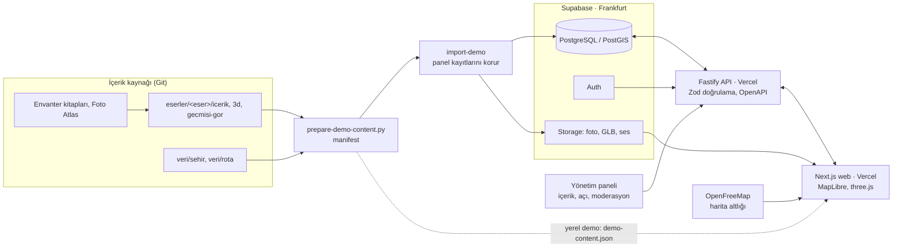

# Mimari ve veri modeli

Şartname §5.1.2 ve §5.4 için tek sayfa.

## Paylaşılan kod
`packages/domain` tipler ve iş kuralları, `packages/api-client` HTTP ve yerel istemci, `packages/design-tokens` tasarım değişkenleri.

## Temel veri modeli
- **Şehir:** kimlik (renk, desen, amblem), harita görünümü, sahne ışığı.
- **Eser:** tür, rol (hayrat veya akar), konum, kaynaklar.
- **Hikâye cümlesi:** metin, kaynak ve güven etiketi, fotoğraf, 3D açı, vurgulanan parçalar, varsa gelir yolu (`flow`).
- **Model:** sunum, gece ve pişmiş harita dosyaları, parça adları.
- **Parça kartı, «Eser hakkında» bölümü, görev, rozet, rota.**
- **Anı (İz Bırak):** moderasyon durumu, KVKK rıza kaydı.

## Güven kuralı
Her içerik `verified`, `inferred` ya da `representative` etiketi ve kaynak taşır. Doğrulanmış olan için etiket gösterilmez; çıkarım ve temsilî olan her zaman işaretlidir.

## Yeni eser ya da şehir eklemek
1. **Panelden:** Eser, hikâye, açı, kart, görev kod değişmeden eklenir. CSV içe aktarma da var.
2. **Paketle:** `eserler/<eser>/` klasörü ve `eser.json`, sonra `import-demo`.
3. **Yeni şehir:** `veri/sehir/<il>.json` ve içe aktarma. Kod değişmez.
4. **3D isteğe bağlıdır:** Modeli olmayan eser fotoğraflarıyla açılır.

## Performans kararları
Harita için ışığı dokuya pişirilmiş dosyalar, yakında sunum modeline geçiş, malzemeye göre birleştirme, görüntü boyutuna göre fotoğraf, telefonda sade çizim.
